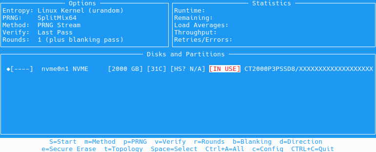

### 1. Overview
The drive selection screen is where you decide which discs are going to be wiped and what settings are going to be used. If you don't understand which settings to use, then for modern SATA/IDE/SAS (post 2000), (all of which are non MFM drives) just use the default settings. Wiping SSD and NVMe will be considered separtely as they have specific requirements that need to be considered before using a traditional block erasure. Preferanbly a sanitise (purge) method will be used on SSD/NMVe drives which is descibed elsewhere on this page.

Enabling a specific drive is achieved by using the <kbd>↑</kbd> and <kbd>↓</kbd> arrow keys and then press <kbd>Space</kbd> to enable the drive for wiping. &gt;[wipe] will be displayed at the start of the drive line which indicates this specific drive will be wiped upon starting the wipe by using shift-s (capital S). If the drive supports native sanitize and you wish to sanitize (purge) the drive use the up/down arrow keys to highlight the drive then press the right arrow key. As of nwipe v0.43 only one drive can be sanitized at a time unlike traditional block writing where multiple drives can be simultaneously erased.

- &gt;[wipe] = Drive will be wiped.
- &gt;[&nbsp;&nbsp;&nbsp;&nbsp;] = Drive will not be wiped.
- &gt;[&#45;&#45;&#45;&#45;] = Drive is mounted and can't be selected for wiping.

Drives currently mounted by the operating system are flagged as [IN USE] and cannot be wiped until unmounted. This is to avoid accidently overwriting a mounted drive when nwipe is being run on a linux distribution. You normally won't see this warning as ShredOS operates in RAM as a disc less system and no drives are mounted at boot. If you are using nwipe on a linux distro you can overide this prevention measure by using the -f (force) option when executing nwipe. e.g. `sudo ./nwipe -f`

### 2. Drive Selection Panel Descriptions

The drive selection screen consists of 4 panels and a title bar.
* **Top Left Panel `Options`** This panel contains the currently selected settings for `entropy` type, `PRNG` type (psuedo random number generator), `Method` type, `Verify` off/last/all, number of `rounds` and whether final `blanking` (writing zeros) is switched on or off. Each of these will be described below. These values are user selectable via the shortcut keys which are displayed on the shortcut keys help bar on the bottom of the screen. These default values can also be set via the command line, e.g `sudo ./nwipe method=is5enh`. For a full list of command line options run `sudo ./nwipe --help`

* **Top Right Panel `Statistics`** This panel show information once the disk or disks being wiped have started.

### 3. Shortcut Keys

